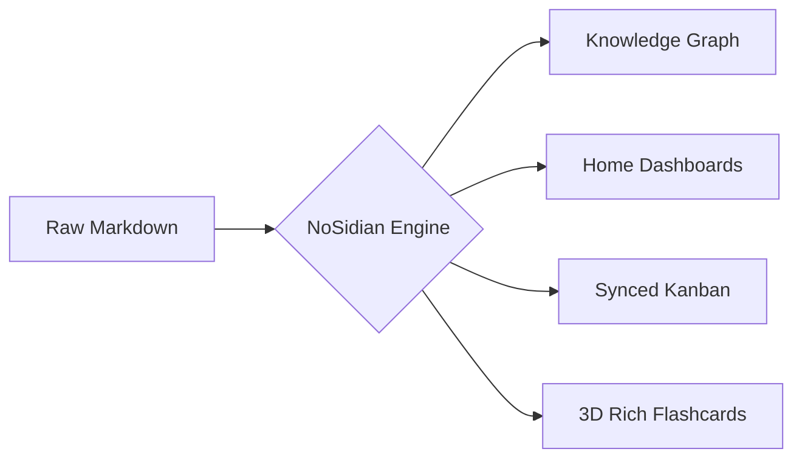

# Markdown, Math & Diagrams

## 1. Callouts & Formatting
> [!info] Standard & Foldable Callouts
> Supports **bold**, *italic*, ==highlights==, ++underlined text++, and <u>inline HTML underline</u>.

> [!warning]- Collapsible Warning (Click to expand)
> Collapsed by default using `[!warning]-` syntax!

## 2. LaTeX Mathematics (KaTeX)
Euler's identity inline: $e^{i\pi} + 1 = 0$

Cosine similarity used internally by NoSidian's TF-IDF engine:
$$\text{Similarity}(A, B) = \frac{A \cdot B}{\|A\| \|B\|}$$

## 3. Mermaid Diagrams


## 4. Syntax-Highlighted Code
```typescript
export function connectIdeas(source: string, target: string): string {
  return `[[${source}]] <-> [[${target}]]`;
}
```

Return to [[Welcome to NoSidian]] or explore [[Second Brain Architecture]].
